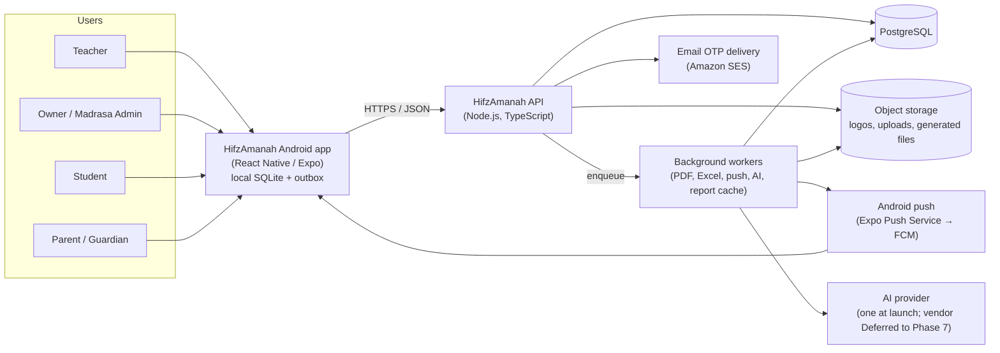
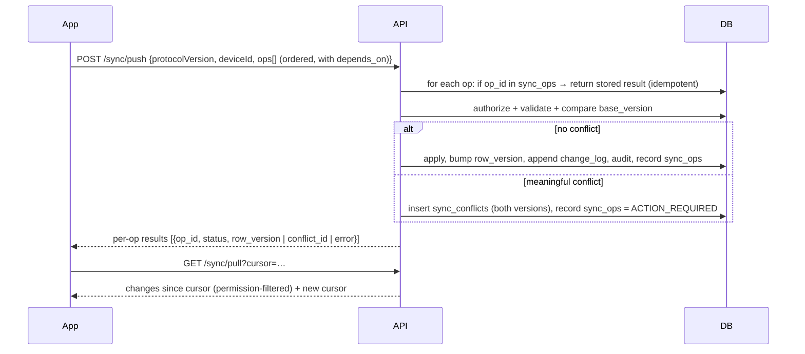
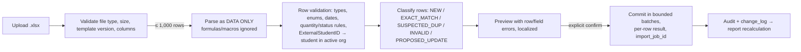

# HifzAmanah — System Architecture

**Document type:** System architecture (planning baseline)
**Status:** Planning only — not implemented
**Version:** 1.1
**Last updated:** 2026-10-30
**Requirements baseline:** `SRS.md` v1.11 (decision register §17, closed 2026-10-30), `user-stories.md` v1.4 (73 stories / 17 epics), `design.md` v1.6
**Changes in 1.1:** Every "Proposed" item and ADR-001…011 was approved on 2026-10-30 (SRS §17 DEC-B51). The open gates are closed, and §7.3 is the approved matrix. The data model gained new attendance statuses, Leave, two-factor sign-in, the "all classes" flag, extra portions, and publishing. Two items are Deferred: the Android application ID and the AI provider vendor.

> This document describes how HifzAmanah should be built. It does not authorize implementation. The decisions it depends on were closed on 2026-10-30 (SRS §17). Items formerly marked **Proposed** are now **Approved**; a change to any of them needs a new ADR and the product owner's approval. Two items remain **Deferred**: the Android application ID and the AI provider vendor.

---

## 1. Architectural drivers

These requirements shape the architecture the most. Each design choice below traces back to one or more of them.

| # | Driver | Source |
|---|---|---|
| D1 | Teachers must record attendance, daily Hifz portions, attempts, and draft homework **offline**, with durable local saves and idempotent sync later. | NFR-OFF-001…010, FR-SYNC-006…009, US-051…054 |
| D2 | **Tenant isolation** and role/assignment-scoped access are enforced **server-side** for every record, export, PDF, notification, and AI request. | FR-SEC-001…010, NFR-SEC-007, US-008, US-068 |
| D3 | **Reports are derived** from source records and must be reproducible. Offline reports are labeled provisional; server reports are authoritative. | FR-RPT-001…009, NFR-OFF-008, US-039…043 |
| D4 | **Exact quantity math** with explicit units. Incompatible units are never added. Missing data never becomes zero. | FR-QTY-001…008, FR-ATT-007/008, FR-RPT-004/005 |
| D5 | **Homework is teacher-confirmed.** Suggestions stay drafts until confirmed. Source edits recalculate drafts but never silently change confirmed homework. | FR-HW-001…015, US-033…038 |
| D6 | **Private teacher notes never leak** to Student/Parent surfaces (API, app, PDF, Excel, push). | FR-SEC-006, FR-PORT-003/004, US-046, US-057 |
| D7 | **Three languages:** English (LTR), Urdu (RTL), Roman Urdu (LTR). Quranic Arabic is preserved exactly. Stored values are language-neutral. | FR-I18N-001…008, NFR-MNT-003, US-047…050 |
| D8 | **AI is optional, online-only, advisory, minimized, and can never write** to authoritative records. A provider failure blocks nothing. | FR-AI-001…012, NFR-AI-001…004, US-062…065 |
| D9 | **Auditability** of sensitive changes, with no secrets in logs. | FR-AUD-001…004, US-009, US-069 |
| D10 | **Safe Excel import/export:** preview, append-first, max 1,000 rows per file, formula-injection protection. | FR-XLS-001…017, US-058…061 |

---

## 2. System context



**Decided:** Android only for every role in MVP (no web portal); React Native/Expo; SQLite on the device; Node.js API; PostgreSQL; HTTPS everywhere (SRS §3.1, §3.2, §16.3). **Approved 2026-10-30:** AWS Mumbai hosting, Amazon SES, Expo Push Service, and authentication built into the API (SRS §17).

---

## 3. Container view

### 3.1 Android app (`apps/mobile`)

| Concern | Choice | Status |
|---|---|---|
| Framework | React Native + Expo (development builds, not Expo Go, for native modules) | Decided (RN/Expo); build mode Approved |
| Language | TypeScript (strict) | Approved |
| Local DB | `expo-sqlite` + a typed query layer (e.g. Drizzle ORM for SQLite) with versioned local migrations | Approved |
| Server state | TanStack Query for online-only reads (Student/Parent views, AI, authoritative reports) | Approved |
| Navigation | React Navigation with role-specific navigators (`TeacherNavigator`, `AdminNavigator`, `StudentNavigator`, `GuardianNavigator`) | From `design.md` §9 |
| i18n | i18next + ICU message format; locales `en`, `ur`, `ur-Latn` (Roman Urdu) | Approved |
| Secure storage | `expo-secure-store` for refresh token and device key | Approved |
| Push | `expo-notifications` with Expo Push Service (FCM underneath) | Approved (FR-NOT-004) |

**Role behavior on device**

- **Teacher / Admin:** offline-capable. Their permitted working set (assigned classes, students, recent records, Quran metadata, calendar) is cached in SQLite. Writes go to the local DB and the outbox first.
- **Student / Parent:** online-only, read-only. No offline report cache is needed in MVP (NFR-PORT-005). Their data is not stored in the offline SQLite working set.

### 3.2 API (`apps/api`)

| Concern | Choice | Status |
|---|---|---|
| Runtime | Node.js LTS, TypeScript | Decided (Node.js) |
| HTTP framework | Fastify (schema-first, fast, good plugin model) | Approved |
| Validation / contracts | Zod schemas shared with the app through `packages/contracts` | Approved |
| DB access | Drizzle ORM or Kysely over `pg`, with SQL migrations in version control | Approved (the one chosen at scaffolding is recorded in an ADR; versioned migrations Decided, NFR-MNT-002) |
| Job queue | `pg-boss` (Postgres-backed, so no extra Redis service in MVP) | Approved |
| Password hashing | Argon2id | Approved |
| API style | REST + JSON for resources; dedicated `/sync/push` and `/sync/pull` endpoints for offline sync | Approved |

The API is a **modular monolith**: one deployable unit with strict module boundaries (§5). This suits the team size and MVP scope, and it keeps transactions simple. It can be split later if needed.

### 3.3 Workers (`apps/api` worker entrypoint)

These use the same codebase as the API but run as a separate process. They consume `pg-boss` jobs:

- `excel.import.validate`, `excel.import.commit`, `excel.export`
- `pdf.render`
- `push.send`
- `ai.recommend`
- `report.rebuild` (cache rebuild after source changes)

Any job that can be retried must be idempotent: it is keyed by job ID and by the business key of each target row.

### 3.4 PostgreSQL

- One shared database. Every tenant-owned table has `organization_id NOT NULL`.
- **Row-Level Security (RLS)** is added as a defense-in-depth layer: each request sets `app.current_org_id` inside its transaction. Application-level checks remain the primary control (§7).
- Separate DB roles: `app_rw` (API), `app_migrate` (migrations), `app_audit_writer` (INSERT only on `audit_logs`). Least privilege follows NFR-SEC-005.

### 3.5 Object storage

S3-compatible storage holds org logos (PDF templates), uploaded `.xlsx` files (short retention), and generated PDF/XLSX files. Files are served only through short-lived signed URLs issued after an authorization check. **Provider: AWS S3, Mumbai region (approved, SRS NFR-PERF-006).** Retention follows SRS NFR-PRV-005.

---

## 4. Repository layout (approved monorepo)

```text
hifz-amanah/
  apps/
    mobile/                 # React Native / Expo Android app
      src/
        theme/              # tokens from design.md §2 (colors, typography, spacing, radius)
        i18n/               # en / ur / ur-Latn resources, direction helpers, glossary
        components/         # AppScreen, Button, FormField, QuantityField, PortionCard, StatusChip, SyncStatusBanner …
        navigation/         # Teacher / Admin / Student / Guardian navigators
        features/           # auth, workspaces, classes, students, attendance, daily-entry,
                            # homework, reports, sync, import-export, analytics, settings, audit
        local-db/           # SQLite schema, local migrations, repositories, outbox
        sync/               # sync engine (push/pull, retry/backoff, conflict store)
    api/
      src/
        modules/            # one folder per bounded module (§5)
        platform/           # http, auth middleware, tenant context, db, jobs, storage, logging
        workers/            # job handlers
      migrations/           # versioned SQL migrations
  packages/
    domain/                 # PURE TypeScript domain rules (no I/O): quantities, statuses,
                            # carry-forward eligibility, report aggregation, analytics
    contracts/              # Zod schemas: API DTOs, sync operations, enums, error codes
    i18n-keys/              # typed message keys shared by app and server (PDF/Excel/push labels)
  docs/
    adr/                    # architecture decision records
    specs/                  # one spec per user story, grouped by feature (docs/specs/README.md)
    SRS.md  user-stories.md  design.md  ARCHITECTURE.md  AGENTS.md  00-product-brief.md
```

**Why `packages/domain` is shared:** NFR-MNT-001 requires domain rules to be centralized on the server. But offline provisional reports (NFR-OFF-008, US-062) need the same math on the device. A single pure package, used by both sides, prevents drift. **The server's result is always authoritative.** The device uses the package only for provisional display and for local validation before queuing.

---

## 5. Domain modules

Each module owns its tables, services, and API routes. Other modules call it only through its service interface, never by querying its tables directly.

| Module | Responsibility | Key requirements / stories |
|---|---|---|
| `identity` | Accounts, User ID + password login, sessions, email-OTP recovery, profile, language preference | FR-AUTH-*, US-001…006, US-070 |
| `organization` | Workspaces (individual teacher / madrasa), memberships, roles, org settings (timezone, week start, daily-report mode, AI config) | FR-ORG-*, US-007, US-019 |
| `access` | Policy engine: role + tenant + assignment scope + audience projection | FR-SEC-*, US-008, US-046, US-068 |
| `roster` | Classes, teacher assignments, students, enrollments (with history), guardian links | FR-CLS-*, FR-STU-*, US-010…012 |
| `calendar` | Class schedules, holidays/closures/no-class days, attendance (Present/Late/Half day/Leave/Absent), Leave approval | FR-CAL-*, US-013…017 |
| `quran-ref` | Admin-managed Surah/Ayat/Para metadata, 15-line Mushaf configuration, range validation | FR-SAB-005/006, US-024…026 |
| `hifz` | Daily records, lesson portions, attempts, mistakes, quality, performance labels, note visibility | FR-DAY-*, FR-SAB/SBQ/MNZ-*, FR-ATT-*, US-018…032 |
| `homework` | Assignments, portions, suggestion engine, review/confirm/revise lifecycle | FR-HW-*, US-033…038 |
| `reporting` | Weekly/monthly reports, report cache, PDF rendering, report templates | FR-WKR/MNR/RPT/PDF/EXP-*, US-039…043, US-055…057 |
| `portal` | Student/Parent read-only report APIs (published, projected) | FR-PORT-*, US-044…046 |
| `sync` | Push/pull protocol, idempotency, change log, conflicts | NFR-OFF-*, FR-SYNC-*, US-051…054 |
| `import-export` | Excel templates, import jobs, preview, batched commit, exports | FR-XLS-*, US-058…061 |
| `analytics` | Deterministic metrics (shared `packages/domain`), AI gateway | FR-AI-*, US-062…065 |
| `notifications` | Device tokens, preferences, event catalogue, push dispatch | FR-NOT-*, US-066/067 |
| `audit` | Append-only audit log, audit query API | FR-AUD-*, US-009, US-069 |

---

## 6. Data architecture

### 6.1 Conventions

- **Primary keys:** UUIDv7, generated **by the client** for offline-creatable entities (daily records, portions, attempts, mistakes, attendance, homework drafts, notes) and by the server for everything else. This gives stable IDs for idempotent sync (FR-SYNC-006).
- **Tenant column:** `organization_id` on every tenant-owned table. It is included in composite foreign keys where practical, so a cross-tenant reference cannot be created.
- **Row versioning:** `row_version BIGINT` incremented by the server on each write. It is used for optimistic concurrency and conflict detection.
- **Change log:** each write also appends to `change_log(organization_id, seq BIGSERIAL, entity, entity_id, op)`. This drives incremental `/sync/pull` and report-cache invalidation.
- **No hard deletes** of teaching data. Use `deactivated_at` / `status` instead. No `ON DELETE CASCADE` into history or audit tables (SRS §6.3).
- **Enums** are canonical English identifiers (e.g. `NOT_REMEMBERED`) stored as Postgres enums or checked text. Labels are localized only in the UI (NFR-MNT-003).
- **Dates:** `report_date` is a calendar `DATE` in the organization's timezone (default `Asia/Karachi`). It is separate from `client_saved_at` and `server_received_at`. A late sync never changes `report_date` (SRS §16.5).

### 6.2 Quantity representation (D4)

A quantity is stored as **`(unit, numerator, denominator)`**. Never use floats.

| Canonical unit | Allowed values | UI presets |
|---|---|---|
| `PARA` | rational, 0 < q ≤ 1 per portion (denominator 4 in MVP) | Rubu = 1/4, Half = 1/2, Salasah = 3/4, Complete = 1 |
| `LINES` | integer ≥ 0 (15-line Mushaf) | — |
| `AYAT` | integer ≥ 0 | — |
| `PAGES` | integer ≥ 0 | — |

- The Excel `QuantityUnit` values `RUBU`, `HALF`, `SALASAH`, `COMPLETE` map to `PARA` with the matching fraction. `LINES`, `AYAT`, and `PAGES` map one to one.
- `remaining = max(0, assigned − completed)` is computed only when both quantities have the same unit **and** belong to the same portion (FR-QTY-005).
- Aggregation groups by unit. The domain package has **no** cross-unit conversion. Any future conversion requires an approved ADR.
- `completed ≤ assigned` is enforced. Extra work beyond the assigned amount is recorded as a separate portion with `is_extra = true` (SRS FR-QTY-006, design D6). `LINES`, `AYAT`, and `PAGES` are whole numbers (FR-QTY-009).

### 6.3 Core tables

```text
identity / organization
  users(id, organization_id, login_id UNIQUE, password_hash, email NULL, display_name,
        preferred_locale, status, created_at, …)
  memberships(id, organization_id, user_id, role, all_classes BOOLEAN DEFAULT false,   -- FR-SEC-003
              status, created_at, revoked_at)
  user_totp(user_id, secret_encrypted, enabled_at)                     -- Owner/Admin 2FA, FR-AUTH-016
  recovery_codes(id, user_id, code_hash, created_at, used_at)
  sessions(id, user_id, refresh_token_hash, device_id, expires_at, revoked_at)
  password_reset_otps(id, user_id, otp_hash, expires_at, attempts, consumed_at)
  organizations(id, kind[INDIVIDUAL|MADRASA], name, timezone='Asia/Karachi',
                week_start='MONDAY', daily_report_mode[SINGLE|MULTI_SESSION]='SINGLE', …)
  org_ai_settings(organization_id, enabled, provider, monthly_cap_usd DEFAULT 10, limits jsonb,
                  data_categories jsonb)                              -- FR-AI-012/013
  report_templates(organization_id, logo_object_key, colors jsonb, headings jsonb, layout jsonb)

roster
  classes(id, organization_id, name, status)      -- active names unique per org, case-insensitive (FR-CLS-003)
  class_teachers(organization_id, class_id, teacher_user_id, assigned_at, unassigned_at)
  students(id, organization_id, external_student_id NULL, name, admission_date, status, …)
  student_enrollments(id, organization_id, student_id, class_id, start_date, end_date)  -- one active per student (FR-STU-006)
  student_accounts(organization_id, student_id, user_id)               -- student login
  student_guardians(organization_id, student_id, guardian_user_id,
                    verified_by, verified_at, verification_method, revoked_at)   -- FR-PORT-007

calendar
  class_schedules(id, organization_id, class_id, weekday, start_time, end_time,
                  effective_from, effective_to)
  calendar_exceptions(id, organization_id, class_id NULL, date, kind[HOLIDAY|CLOSURE|NO_CLASS], label)
  attendance_records(id, organization_id, student_id, class_id, report_date, session_label NULL,
                     status[PRESENT|LATE|HALF_DAY|LEAVE|ABSENT],                       -- FR-CAL-007
                     leave_status[NONE|REQUESTED|APPROVED|REJECTED], leave_reason NULL,  -- FR-CAL-008, internal
                     leave_requested_by, leave_decided_by, leave_decided_at,
                     absent_note NULL,                                                   -- FR-DAY-010, internal
                     recorded_by, row_version)

quran-ref (per organization, Admin-maintained)
  quran_surahs(organization_id, number, name_ar, name_translit, ayah_count)
  quran_paras(organization_id, number, start_surah, start_ayah, end_surah, end_ayah)
  mushaf_layout(organization_id, edition='STANDARD_15_LINE', page, line, surah, ayah_start, ayah_end)

hifz
  daily_records(id, organization_id, student_id, class_id NULL, report_date, session_label NULL,
                overall_label NULL[EXCELLENT|GOOD|AVERAGE|NEEDS_IMPROVEMENT],
                recorded_by, client_saved_at, server_received_at, row_version)
  lesson_portions(id, organization_id, daily_record_id, section[SABAQ|SABQI|MANZIL], position,
                  para_number, surah_start, ayah_start, surah_end, ayah_end, is_extra BOOLEAN,
                  assigned_unit, assigned_num, assigned_den,
                  homework_portion_id NULL, row_version)
  portion_attempts(id, organization_id, lesson_portion_id, attempt_no, attempted_at, recorded_by,
                   completed_unit, completed_num, completed_den,
                   status[COMPLETED|PARTIAL|NOT_REMEMBERED|ABSENT|NOT_ASSIGNED|PENDING],
                   quality SMALLINT NULL CHECK (quality BETWEEN 1 AND 5),
                   mistake_count_summary NULL,           -- from Excel MistakeCount only
                   no_mistakes BOOLEAN DEFAULT false,    -- explicit "No mistakes" = 0 (FR-ATT-011)
                   remaining_snapshot_*  NULL,           -- attempt-time snapshot (FR-ATT-006)
                   row_version)
  attempt_mistakes(id, organization_id, attempt_id,
                   category[HARKAAT|TAJWEED|LAFZI|AYAT_BHOOLNA|TARTEEB|WAQF_IBTIDA],
                   severity[MINOR|MAJOR], repeated BOOLEAN, note NULL,
                   note_visibility[INTERNAL|SHARED] DEFAULT 'INTERNAL')   -- FR-ATT-012
  notes(id, organization_id, target_type, target_id, body,
        visibility[INTERNAL|SHARED] DEFAULT 'INTERNAL', author_id, row_version)

homework
  homework_assignments(id, organization_id, student_id, class_id NULL, source_daily_record_id NULL,
                       assigned_date, due_date, status[DRAFT|CONFIRMED|SUPERSEDED|REJECTED],
                       revision_of NULL, created_by, confirmed_by, confirmed_at, instructions, row_version)
  homework_portions(id, organization_id, assignment_id, section, para_number, surah/ayah range,
                    assigned_unit/num/den, status, source_homework_portion_id NULL,
                    source_attempt_id NULL, origin[SUGGESTED|TEACHER_ADDED|TEACHER_EDITED], instructions)

reporting / platform
  report_published(organization_id, student_id, period_kind, period_start, published_by, published_at,
                   updated_after_publish_at NULL)                      -- FR-RPT-010
  report_cache(organization_id, student_id, period_kind, period_start, source_seq, payload jsonb)
  change_log(organization_id, seq BIGSERIAL, entity, entity_id, op, at)
  sync_ops(organization_id, op_id UUID PRIMARY KEY, device_id, user_id, received_at, result jsonb)
  sync_conflicts(id, organization_id, entity, entity_id, local_payload, server_payload,
                 base_version, status[OPEN|RESOLVED], resolved_by, resolution)
  import_jobs(id, organization_id, kind, file_object_key, status, row_count, summary jsonb, created_by)
  import_rows(job_id, row_no, status[NEW|EXACT_MATCH|SUSPECTED_DUP|INVALID|PROPOSED_UPDATE|COMMITTED|FAILED],
              errors jsonb, target_id NULL)
  device_tokens(id, user_id, organization_id, token, platform, last_seen_at, revoked_at)
  notification_prefs(user_id, organization_id, event_type, enabled)
  ai_requests(id, organization_id, requested_by, provider, input_hash, metrics_payload jsonb,
              output jsonb, status, tokens_in, tokens_out, cost_estimate, created_at)
  audit_logs(id, organization_id, actor_user_id, action, entity_type, entity_id, at,
             summary jsonb)                                  -- append-only
```

### 6.4 Daily-report mode uniqueness (FR-DAY-008)

- `SINGLE` (default): a partial unique index on `(organization_id, student_id, report_date) WHERE session_label IS NULL`.
- `MULTI_SESSION`: unique on `(organization_id, student_id, report_date, session_label)`, and `session_label` is required.
- **Switching modes** is an Admin action that validates existing data first. Switching from `MULTI_SESSION` to `SINGLE` is blocked if any student/date has more than one session. Reports aggregate sessions per date in both modes.

### 6.5 Attendance vs. performance (FR-CAL-003, FR-ATT-002)

Attendance lives in `attendance_records`. Performance lives in `portion_attempts`. Bulk Entry writes **only** `attendance_records` with `PRESENT`/`ABSENT` (FR-DAY-002A).

- **Scheduled class days** are computed from `class_schedules` minus `calendar_exceptions`. Days that are not scheduled are never counted as absences (FR-CAL-004).
- **Leave (replaces excused absence, FR-CAL-008):** a Teacher records `LEAVE` with a reason and `leave_status=REQUESTED`. An Admin moves it to `APPROVED` or `REJECTED`. Leave recorded by an Owner/Admin is `APPROVED` at once.
- **Counting (FR-CAL-005):** attended = `PRESENT + LATE + HALF_DAY`; approved `LEAVE` is its own count; `ABSENT` and rejected `LEAVE` are normal absences.
- **Holidays declared later (FR-CAL-009):** attendance and daily records on a date that later becomes a `calendar_exceptions` holiday are excluded at report time. They are never deleted.
- **Unmarked students (FR-CAL-010):** no row is written until the Teacher confirms "Mark them Absent".

---

## 7. Security architecture (D2, D6)

### 7.1 Authentication (approved 2026-10-30: built into the API)

- **Login** uses `login_id` + password. Email is never a login identifier.
- **Approved (FR-AUTH-013):** `login_id` is globally unique and case-insensitive (3–32 letters, digits, hyphens). A person in several madaris has one account per madrasa (FR-AUTH-011), each with its own `login_id`. An org-code prefix (e.g. `ALNOOR-T014`) is recommended so IDs stay readable and unique.
- **Sessions:** a short-lived access token (JWT, ~15 min) plus a rotating opaque refresh token, stored hashed server-side with reuse detection. Sign-out and admin revocation delete or revoke the refresh tokens (FR-AUTH-003).
- **Brute-force protection:** rate limiting per `login_id` and per IP, plus progressive delay. Login errors never reveal whether the ID exists.
- **Password recovery:** the user enters their `login_id` (not their email, because Student and Parent may share one email). A 6-digit OTP goes to that account's registered email. The OTP is stored hashed, has a ~10-minute TTL, allows at most 5 attempts, and is rate-limited per account. A successful reset revokes all of that account's sessions and is audited (FR-AUTH-007, US-002, US-070).
- **Account creation:** only Admins create Teacher, Student, and Parent accounts and set their initial passwords. No forced password change at first login (FR-AUTH-009/010). The platform operator creates each workspace and its first Owner (FR-ORG-001).
- **Password policy (FR-AUTH-012):** 8–64 characters, no composition rules, blocklist of common passwords and the User ID.
- **Lockout (FR-AUTH-014):** progressive delay after 5 failures; 10 failures in 15 minutes lock the account for 15 minutes. Locks are audited.
- **Admin reset (FR-AUTH-015):** Owner/Admin may set a user's password directly; this revokes sessions and is audited. Only the Owner resets an Admin.
- **Two-factor (FR-AUTH-016):** Owner/Admin must use TOTP plus 10 hashed one-time recovery codes. Regeneration needs recent sign-in and TOTP. The Owner resets an Admin's 2FA; the operator resets an Owner's.

### 7.2 Authorization pipeline

Every request passes through these layers:

```text
request
 → authenticate (token → user, membership, organization)       FR-SEC-001
 → tenant context (org from membership — NEVER from body/URL)  FR-SEC-009, FR-XLS-015
 → policy check  can(actor, action, resource)                  FR-SEC-002/003
     · role permission (matrix §7.3)
     · scope: teacher → assigned classes/students only
              student → own student_id
              parent  → verified, non-revoked student_guardians links
     · resource loaded WITH organization_id filter → 404 if not found (no ID probing, FR-SEC-008)
 → domain service (business rules, transaction, audit write)
 → audience projection (§7.4)
 → response
```

RLS in Postgres acts as a second line of defense against a missing `WHERE organization_id = …` filter.

### 7.3 Role/permission matrix — approved 2026-10-30 (SRS §17.1)

| Capability | Owner | Admin | Teacher | Student | Parent |
|---|:-:|:-:|:-:|:-:|:-:|
| Org settings, daily-report mode, AI config, report template | ✔ | ✔ | — | — | — |
| Add/remove Admins, transfer ownership | ✔ | — | — | — | — |
| Create Teacher/Student/Parent accounts, set or reset passwords | ✔ | ✔ (not Admin/Owner passwords) | — | — | — |
| Set a Teacher's "all classes" flag | ✔ | ✔ | — | — | — |
| Classes, schedules, holidays | ✔ | ✔ | view assigned | — | — |
| Add/edit students (incl. Excel import) | ✔ | ✔ | assigned only | — | — |
| Deactivate/move students, guardian links | ✔ | ✔ | — | — | — |
| Quran metadata | ✔ | ✔ | view | — | — |
| Bulk attendance, daily entry, attempts, Excel daily-record import | ✔ | ✔ | assigned only | — | — |
| Mark Leave | ✔ (approved at once) | ✔ (approved at once) | assigned only (awaits approval) | — | — |
| Approve/reject Leave | ✔ | ✔ | — | — | — |
| Homework draft/confirm | ✔ | ✔ | assigned only | — | — |
| Revise confirmed homework | ✔ | ✔ | — | — | — |
| Resolve sync conflict | ✔ | ✔ | own conflicts | — | — |
| Publish reports | ✔ | ✔ | assigned only | — | — |
| Class summary report | ✔ | ✔ | assigned only | — | — |
| Weekly/monthly reports, PDF, Excel export | ✔ | ✔ | assigned only | own, published | linked, published |
| Internal notes | ✔ | ✔ | assigned only | ✘ | ✘ |
| AI recommendations | ✔ | ✔ | assigned only (if enabled) | ✘ | ✘ |
| Audit history | ✔ | ✔ | own actions only | — | — |

"Assigned only" means the Teacher's assigned classes, or every class when the Teacher has the "all classes" flag (FR-SEC-003).

### 7.4 Audience projection (single choke point for D6)

`projectFor(audience, entity)` in the `access` module is the **only** way to turn domain data into an outbound payload. It is used by:

- API responses
- PDF rendering
- Excel export
- push payload building
- AI payload building

For `STUDENT` and `PARENT` audiences it removes `notes.visibility = INTERNAL`, internal fields, and unpublished periods. Contract tests assert this for every outbound channel (AC-SEC-04, AC-XLS-06).

### 7.5 Other controls

- HTTPS only, with HSTS.
- Secrets live in the platform secret store and never in the repo or the app bundle (NFR-SEC-004). AI provider keys exist **only** on the server.
- Parameterized SQL only. Zod validates every input. The server recomputes all totals; client-sent totals are ignored (FR-SEC-009).
- Logs are structured with PII redaction. Passwords, OTPs, tokens, and note bodies are never logged (FR-AUD-003, NFR-REL-004).
- Synthetic seed data only in non-production environments (NFR-PRV-003).

---

## 8. Offline and synchronization architecture (D1)

### 8.1 Device storage

```text
SQLite (per signed-in account + organization)
  entity tables (mirror of permitted server data + local edits)
  outbox(op_id, seq, entity, entity_id, op_type, payload, base_version,
         depends_on[], state[PENDING|SYNCING|SYNCED|FAILED|ACTION_REQUIRED],
         attempts, last_error, created_at)
  sync_meta(last_pull_cursor, last_success_at, protocol_version, schema_version)
  conflicts(local copy of server conflicts for review UI)
```

**Save path (NFR-OFF-002):** the entity write and the outbox insert happen in **one SQLite transaction**. The UI shows "Saved on device" only after that commit. "Synced" appears only after the server acknowledges the operation (FR-SYNC-007, `design.md` §8).

### 8.2 Protocol



- **Idempotency:** `op_id` (a client UUID) is the primary key of `sync_ops`. A replayed operation returns the stored result and creates no duplicate (NFR-OFF-004).
- **Ordering:** operations carry `depends_on`. The server rejects an operation whose dependency has not been applied, using the retryable error `DEPENDENCY_PENDING`. The client sends operations in outbox order.
- **Retry:** exponential backoff with jitter. A `FAILED` operation stays visible with its reason (NFR-OFF-007).
- **Versioning:** `protocolVersion` is checked on every request. The server answers `UPGRADE_REQUIRED` for unsupported clients, and pending operations are kept.
- **Conflicts (FR-SYNC-008):** these fields are "meaningful": attempt status, quantities, quality, mistakes, attendance status, and homework status/portions. If one of them changed on both sides since `base_version`, a conflict is created. Last-write-wins is never used for them. Non-meaningful fields (e.g. display ordering) may use a documented safe merge. An authorized user resolves the conflict in the Conflict Review screen. The resolution is a new operation and is audited.
- **Revocation (NFR-OFF-010, FR-SYNC-009):** if push or pull returns `ACCESS_REVOKED`, the app stops syncing that workspace and locks its cached data. Unsynced operations stay visible but cannot be sent. Synced data is purged at once. Unsynced operations stay locked and visible, and are purged on sign-out or after 30 days (NFR-OFF-011). The app lock (PIN or fingerprint) is required for Owner/Admin and optional for Teachers; it locks after 5 minutes in the background. Synced daily records older than 120 days are removed from the device cache.
- **Sign-out with pending operations** shows a warning (`design.md` §4.13).
- **Local schema upgrades** run in a transaction and are tested with a populated outbox (NFR-OFF-009).

### 8.3 What works offline

| Works offline (Teacher/Admin) | Online only |
|---|---|
| Bulk attendance (all five statuses), Leave request | Sign-in, password reset, two-factor setup |
| Daily entry, portions, attempts, mistakes, quality, notes | Student/Parent views |
| Draft homework suggestions + edits | AI recommendations |
| Provisional weekly/monthly view + analytics (labeled with last sync time and pending count) | Authoritative reports, PDF, Excel import/export |
| | Admin approvals, account management |
| Homework **confirmation** (FR-HW-017): queued as an operation carrying the draft's source `row_version`s. The server re-validates them; if any changed, it creates a conflict instead of confirming | Report publishing, class summary export |

---

## 9. Hifz, homework, and reporting logic

### 9.1 Daily entry flow

1. The teacher selects the date, class (optional), and student.
2. The teacher adds Sabaq, Sabqi, and Manzil portions. Each portion has its own quantity, status, mistakes, quality, and notes (FR-SBQ-004, FR-MNZ-004).
3. Each recitation creates a `portion_attempt`. A later attempt adds a row and never edits the earlier one (FR-ATT-005).
4. `NOT_REMEMBERED` defaults `completed` to 0 (FR-QTY-007). `ABSENT`, `NOT_ASSIGNED`, and `PENDING` carry no quality and are never treated as failure (FR-ATT-007).
5. On save, the domain package recomputes remaining quantities and the **draft** homework suggestion.

### 9.2 Homework suggestion engine (`packages/domain/homework`)

A pure function:

```text
suggest(latestAttemptsByPortion, priorConfirmedHomework, rules) → DraftPortion[]
```

- **Eligible:** the latest attempt is `PARTIAL` or `NOT_REMEMBERED` and has remaining > 0 in the same unit.
- **Excluded:** `ABSENT`, `NOT_ASSIGNED`, `PENDING`, and `COMPLETED` (FR-HW-013).
- Each suggested portion links `source_attempt_id` and `source_homework_portion_id` (FR-HW-014).

**Lifecycle**

```text
DRAFT ──teacher edits/adds/removes──▶ DRAFT ──confirm──▶ CONFIRMED (confirmed_by, confirmed_at, audit)
  │                                                       │
  └──reject──▶ REJECTED                                   └──explicit revise──▶ new assignment (revision_of), old → SUPERSEDED
```

- A source edit triggers recomputation of `DRAFT` assignments only (FR-HW-011).
- `CONFIRMED` assignments are immutable. Changes happen only through an explicit, audited revision (FR-HW-012).
- Confirmation runs in a single transaction (NFR-PERF-003, NFR-REL-003).

### 9.3 Reports (`packages/domain/reports`)

```text
buildReport(period, tz, weekStart, schedule, exceptions, attendance, records, attempts, homework, audience)
```

- **Period boundaries** use the org timezone and a Monday week start (FR-RPT-003).
- **Attendance block:** scheduled, attended (Present + Late + Half day, with Late and Half day also counted separately), Leave, normal absent, holidays, no-class days (FR-CAL-005).
- **Recurring difficulty (FR-MNR-006):** a Para or range with a Major or Repeated mistake in at least 3 attempts in the period, or Not Remembered at least 3 times.
- **Carried-over homework (FR-HW-016):** a confirmed assignment whose due day was Absent, Leave, or a holiday is reported as outstanding and "carried over"; it is never failed and never edited.
- **Class summary (FR-RPT-011):** the same `buildReport` per student, aggregated into one row each.
- **Progress** uses the **latest attempt per portion** for current status. Full history is available separately and is never double-counted (FR-RPT-006).
- **Quantities** are grouped by unit and never mixed (FR-RPT-005).
- **Quality average** includes recorded ratings only and shows `n` (FR-RPT-004). "No data" is shown distinctly from 0. The scale is 1 = Excellent … 5 = Weak, so **lower is better**. The display label is the nearest whole score with .5 rounding up, while the exact average is kept for calculations (FR-ATT-009).
- **Homework counts** report confirmed, draft, attempted, completed, and carried forward separately (FR-RPT-007, FR-MNR-005).
- **Cache:** `report_cache` stores `source_seq`. A change-log entry for an affected student or period invalidates the cache. A nightly verification job recomputes a sample of reports and compares them (FR-RPT-008).
- **Export metadata** includes the period, timezone, filters, `generated_at`, and a pending-offline-changes flag (SRS §15.1).

### 9.4 Deterministic analytics

These use the same domain package: progress by section, assigned vs. completed by unit, mistake category/severity trends, quality trend, recurring difficult portions, and attendance context (FR-AI-001). On the device they are marked **Provisional** (NFR-OFF-008).

---

## 10. PDF and print (US-055…057)

- **Rendering:** server-side, HTML template → PDF via headless Chromium (Playwright). Chromium gives correct Arabic/Urdu shaping, bidi handling, and RTL layout, which lighter PDF libraries handle poorly. ****Approved (ADR-008).****
- **Input:** the output of `buildReport(…, audience)` **after** `projectFor(audience)` (FR-PDF-003).
- **Template:** professional default plus the org's `report_templates` (logo, colors, headings, layout options within fixed controls) (FR-PDF-002).
- **Fonts** are bundled in the renderer: Inter (Latin/Roman Urdu), an Urdu-capable font, and an Arabic Naskh font for Quranic text. **Approved font stack (FR-PDF-004):** Inter, Noto Nastaliq Urdu, Noto Naskh Arabic. A4, with the header repeated on every page and table rows never split across pages.
- Generated files are stored with a short TTL and served by signed URL.

---

## 11. Excel import/export (D10)



- **Library:** `exceljs` on the server (Approved). Import and export run as worker jobs.
- **Mode:** default is **add-new-only**. Update mode requires a stable external key, an explicit user choice, and a field-level before/after preview. Matching by name only is prohibited (FR-XLS-012).
- **Replay safety:** re-importing the same file with stable keys produces `EXACT_MATCH` rows and creates no new records. Row results are stored per `(job_id, row_no)`, so a retried batch skips rows already committed (FR-XLS-013/014).
- **Tenant:** comes from the session only. Any org column in the workbook is ignored (FR-XLS-015).
- **Export safety:** cells beginning with `= + - @ \t \r` are prefixed with `'`. Canonical enums and Arabic text are written unchanged (FR-XLS-009, NFR-XLS-004).
- **Templates** (`Students`, `DailyRecords`) are versioned exactly as specified in SRS §15.1. Each template has a hidden `_meta` sheet with `TemplateName` and `TemplateVersion`. Commits run in batches of 200 rows (FR-XLS-018). A Teacher imports students only into assigned classes (FR-XLS-001).
- **Mapping note:** `DailyRecords.MistakeCount` is a single number, but the in-app model is categorized mistakes. Imported counts go to `portion_attempts.mistake_count_summary`, and reports show them as "uncategorized".

---

## 12. AI recommendations (D8)

```text
App (online, Teacher/Admin) → POST /analytics/{studentId}/ai-recommendation
  → access policy (role, assignment, org AI enabled, usage limits)
  → metrics = analytics.buildMetrics(student, period)          -- deterministic, authoritative
  → payload = minimize(metrics, org.data_categories)           -- pseudonymous: no name, contact, notes
  → provider adapter (timeout, retry once, budget check)
  → validate output against JSON schema + every cited number exists in metrics
  → store ai_requests (input hash, output, usage)
  → response labeled "AI suggestion — review required", with period + cited metrics
```

- **Provider adapter interface:** `recommend(payload, schema, opts) → {output, usage}`. Admin chooses among the integrated adapters. **Budget (approved):** USD 10 per madrasa per month by default; the Admin may lower it (FR-AI-012). **Launch provider: Deferred** to the FR-AI-012 comparison in Phase 7. Data categories: FR-AI-013. Output language: FR-AI-014.
- **No write path:** the AI module has no repository access except `ai_requests`. It cannot create homework or modify records (FR-AI-010).
- **Failure modes:** offline, timeout, budget reached, or disabled → the UI shows deterministic analytics and an "AI unavailable" state. Nothing is fabricated (AC-AI-01, AC-AI-04).

---

## 13. Notifications (US-066/067)

- **Channel:** Android push only (Decided). Provider: Expo Push Service, which delivers through FCM (approved, FR-NOT-004).
- **Payloads are minimal and generic** (e.g. "A new weekly report is available") and carry a deep link. The app fetches the content after authentication, so push never carries student data or notes (FR-NOT-002).
- **Delivery** is a `push.send` job: best-effort, failures logged, never blocks the triggering action (FR-NOT-003).
- **Event catalogue (FR-NOT-004):** one MVP event, "Report published", sent to the Student and linked Parents. It is on by default and can be turned off per user. Android permission is requested when it is first useful.

---

## 14. Localization architecture (D7)

- **Locales:** `en` (LTR), `ur` (RTL), `ur-Latn` Roman Urdu (LTR). The preference is stored on `users.preferred_locale`, applies across sessions, and is also cached locally (FR-AUTH-005, FR-I18N-004).
- **Direction without restart:** React Native's global `I18nManager.forceRTL` needs an app reload, which could discard unsaved work (FR-I18N-005). **Approved (ADR-010):** drive direction from a `DirectionProvider` context (`direction` style plus mirrored layout helpers) so switching language re-renders in place. Additionally, persist form drafts to SQLite continuously, so even a forced reload loses nothing.
- **Quranic text** is rendered in a dedicated `QuranText` component with its own font, `writingDirection: 'rtl'`, and no transliteration or auto-translation (FR-I18N-006).
- **Mixed content:** ranges such as "Para 5 · البقرة 2:255–2:260" use bidi isolation (Unicode FSI/PDI) so numbers and Arabic stay readable in LTR and RTL contexts (FR-I18N-007).
- **Server-side labels** for PDF, Excel, and push come from the same `packages/i18n-keys` catalogues. Every key exists in all three locales; CI fails on a missing key.
- **Glossary:** a Roman Urdu glossary file for domain terms (FR-I18N-008).

---

## 15. Audit (D9)

- Audit rows are written **in the same transaction** as the change they describe.
- The writer role has INSERT-only access. No UPDATE/DELETE grants exist on `audit_logs`.
- **Audited actions include:** account/role/membership changes, password reset, guardian link/verification/revocation, note visibility changes, daily record/attempt create/edit, Leave decisions, attendance changes, "all classes" flag changes, report publishing, 2FA setup/reset and recovery-code regeneration, account locks, homework confirm/revise/reject, Quran metadata edits, daily-report mode change, AI settings change, import/export jobs, conflict resolution, sensitive report access (NFR-PORT-006).
- `summary` holds field names plus old/new values **for non-sensitive fields only**. Note bodies, passwords, OTPs, and tokens are never stored.

---

## 16. Deployment and operations (approved 2026-10-30)

| Environment | Purpose |
|---|---|
| `local` | Docker Compose: Postgres, API, worker, MinIO (S3 stand-in), Mailpit (OTP email capture) |
| `staging` | Production-like, synthetic data, used for acceptance testing |
| `production` | AWS Mumbai: managed Postgres with daily backups kept 30 days + 7-day PITR (NFR-PRV-005), S3, SES; a tested restore runbook (NFR-REL-001/002). Sized for 20 madaris / 200 teachers / 5,000 students; targets in NFR-PERF-006 |

- **Mobile distribution:** EAS Build → Play Console internal/closed/production tracks. Minimum Android 8.0 (API 26) or the Expo SDK minimum, and the device matrix in NFR-COMP-001. **The Android application ID is Deferred** until the domain is registered (DEC-B55).
- **Observability:** structured JSON logs with redaction, error tracking for app and API (Sentry or equivalent, with PII scrubbing), and metrics for sync failures, conflict rate, job failures, AI usage/cost, and push failures.

---

## 17. Testing strategy (NFR-MNT-004; CI gate #10)

| Layer | What | Tooling (Approved) |
|---|---|---|
| Domain unit | Quantity math, status semantics, carry-forward eligibility, report aggregation, timezone/week boundaries — every AC-QTY, AC-ATT, AC-HW, and AC-RPT case from SRS §10 | Vitest + property-based tests (fast-check) for quantity math |
| API integration | Real Postgres; authorization matrix tests per role × endpoint; cross-tenant ID probing (AC-SEC-01…05); projection tests for every outbound channel | Vitest + Testcontainers |
| Sync | Replay/idempotency, dependency ordering, conflict creation, revocation, protocol upgrade, local migration with populated outbox | Integration + device tests |
| Excel | Template validation, 1,000-row limit, duplicate replay, formula-injection escaping (AC-XLS-01…06) | Fixture workbooks |
| PDF | Golden-file visual checks for en/ur/ur-Latn + Arabic | Playwright screenshot comparison |
| Mobile UI | Critical flows: sign-in, bulk attendance, daily entry, homework confirm, offline → sync, language switch preserving draft | Maestro, nightly and before release, on emulators + physical devices (NFR-MNT-005) |
| i18n | Missing-key check, RTL snapshot tests | CI script |
| E2E (spec gate) | Every spec acceptance criterion, end to end against a running environment: API checks (`e2e/api`) and device journeys (`e2e/mobile`). Specs are one per user story (`docs/specs/`); a spec is complete only when `npm run e2e:gate -- US-<nnn>` passes; app-wide journeys (`@APP`) gate the release. See `e2e/README.md` | Playwright Test (API) + Maestro (device) |

---

## 18. Traceability: epics → modules

| Epic | User stories | Modules |
|---|---|---|
| 1 Identity & Authentication | US-001…006 | `identity` |
| 2 Organization & Roles | US-007…009 | `organization`, `access`, `audit` |
| 3 Classes & Students | US-010…012 | `roster` |
| 4 Calendar & Attendance | US-013…017 | `calendar` |
| 5 Daily Hifz Entry | US-018…023 | `hifz`, `sync` |
| 6 Quran Portion & Metadata | US-024…027 | `quran-ref`, `packages/domain/quantity` |
| 7 Mistakes & Quality | US-028…032 | `hifz` |
| 8 Homework & Carry Forward | US-033…038 | `homework`, `packages/domain/homework` |
| 9 Weekly & Monthly Reports | US-039…043 | `reporting`, `packages/domain/reports` |
| 10 Student & Parent Access | US-044…046 | `portal`, `access` |
| 11 Localization & Accessibility | US-047…050 | mobile `i18n`, `packages/i18n-keys` |
| 12 Offline & Synchronization | US-051…054 | mobile `local-db`/`sync`, API `sync` |
| 13 PDF & Print | US-055…057 | `reporting` (PDF) |
| 14 Excel Import & Export | US-058…061 | `import-export` |
| 15 Analytics & AI | US-062…065 | `analytics` |
| 16 Notifications | US-066…067 | `notifications` |
| 17 Security, Audit & Admin | US-068…070 | `access`, `audit`, `identity` |

---

## 19. Architecture decision summary

| ID | Decision | Status |
|---|---|---|
| ADR-001 | Modular monolith API + separate worker process | Approved 2026-10-30 |
| ADR-002 | Shared pure `packages/domain` for rules; server authoritative | Approved 2026-10-30 |
| ADR-003 | Client-generated UUIDv7 + op-id idempotent outbox sync with change-log cursor | Approved 2026-10-30 |
| ADR-004 | Conflicts preserved, never last-write-wins for meaningful fields | Decided |
| ADR-005 | Quantity = `(unit, numerator, denominator)`; no cross-unit conversion | Approved 2026-10-30 |
| ADR-006 | Postgres RLS as defense-in-depth on top of app policy | Approved 2026-10-30 |
| ADR-007 | Single audience-projection function for all outbound channels | Approved 2026-10-30 |
| ADR-008 | Server-side PDF via headless Chromium | Approved 2026-10-30 |
| ADR-009 | Postgres-backed job queue (pg-boss) | Approved 2026-10-30 |
| ADR-010 | In-place direction switching (no forced RTL reload) | Approved 2026-10-30 |
| ADR-011 | Globally unique `login_id`, one account per madrasa | Approved 2026-10-30 |
| ADR-012 | Authentication built into the API; TOTP two-factor sign-in for Owner/Admin | Approved 2026-10-30 |
| ADR-013 | AWS Mumbai hosting with S3 and SES; Expo Push Service for Android push | Approved 2026-10-30 |

### 19.1 Implementation gates (closed 2026-10-30)

Every SRS §13 gate and every design.md §11 item (D1–D8) is closed; SRS §17 is the register. The decisions that shape this architecture:

- **ADR-012 (Approved):** authentication built into the API, with TOTP 2FA for Owner/Admin (gate #1).
- **ADR-013 (Approved):** AWS Mumbai hosting, S3, SES, and Expo Push Service (gates #9, #11).
- **Matrix:** §7.3 (gate #2).
- **Offline homework confirmation:** §8.3 (D2).
- **Publishing:** `report_published` (D3).
- **Leave and attendance counting:** §6.5 (D4, D8).
- **Extra portions:** §6.2 (D6).
- **Excel `_meta` sheet and 200-row batches:** §11 (D7).

**Deferred:**
- The Android application ID (DEC-B55).
- The AI provider vendor (DEC-B45, Phase 7). The provider adapter interface in §12 keeps it swappable.

---

## Appendix A — Source-document inconsistencies (fixed 2026-10-30)

These were found while writing this architecture. All were fixed in the source documents (`SRS.md` v1.8, `user-stories.md` v1.1, `design.md` v1.3). Items that needed a product decision were not decided; they were added as open gates.

| # | Where | Issue | Fix |
|---|---|---|---|
| 1 | `user-stories.md` US-004, 005, 006, 009 | Acceptance criteria were copied from US-003 (US-009 audit had no audit criteria) | Story-specific criteria written from FR-AUTH-*/FR-AUD-* |
| 2 | `user-stories.md` US-010, US-011 | Criteria were about AI/analytics | Rewritten from FR-CLS-001, FR-STU-001/003/004 |
| 3 | `user-stories.md` US-058 | Criteria were about PDF layout | Rewritten from FR-XLS-001/003/010…015 (now 3 criteria; total 188) |
| 4 | `user-stories.md` US-028 | Criteria were about quantity units | Rewritten from FR-ATT-010 |
| 5 | `user-stories.md` US-050 | Criteria didn't mention Quranic Arabic | Rewritten from FR-I18N-006/007 |
| 6 | `user-stories.md` US-033, US-055, US-056, US-057, US-061 | Criteria were copied from Daily Entry or report-derivation stories | Rewritten from FR-HW-001…004, FR-PDF-001…003, FR-EXP-*, FR-XLS-007/009 |
| 7 | `SRS.md` §2.1, §8.1 #9, §8.2 | Described a full-detail bulk-entry grid, contradicting attendance-only Bulk Entry | All now say Present/Absent only |
| 8 | `SRS.md` §8.1 #1 | Listed a "sign-up" screen | Replaced with User ID sign-in + email-OTP reset; no self sign-up |
| 9 | `SRS.md` NFR-UX-001 | Mentioned desktop sizes | Phone + tablet only |
| 10 | `SRS.md` numbering | Two Excel sections; §5.20 used twice | §5.19 Notifications, §5.20 Excel (with FR-XLS-017), §5.21 Audit |
| 11 | `SRS.md` §16.5 | Mentions 2FA/recovery codes not defined for MVP | Added to SRS §13 gate #1 as a decision to make |
| 12 | `SRS.md` §15.1 vs FR-ATT-010 | Excel `MistakeCount` vs. categorized mistakes | Mapping rule added to §15.1 (stored as uncategorized count) |
| 13 | `SRS.md` FR-XLS-001 vs FR-AUTH-009 | Teacher student import vs. Admin-only student creation | Added as SRS §13 gate #13 |
| 14 | `design.md` header and §13 | Referenced SRS v1.6, a missing "Architecture v1.5", and an old story-ID scheme (`US-AUTH-001`…) | Baseline updated; §13 remapped to US-001…US-070 |
| 15 | `design.md` §11 | Listed decided items as open | Split into open SRS gates, open design items D1–D8, and already decided |
| 16 | `design.md` §4.7, §5.4 | "No mistake categories" contradicted FR-ATT-010 | Mistakes now have category, Minor/Major, and a repeated toggle |
| 17 | `design.md` §4.7 | Word labels on quality values 1–5 implied a mapping that FR-ATT-009 did not yet approve | First changed to numbers only. The named scale was then approved (SRS v1.9) and later confirmed as 1 = Excellent … 5 = Weak, with Roman Urdu labels (SRS v1.10 FR-ATT-009). Overall performance label stays separate |
| 18 | `design.md` §4.2, §4.7, §4.14, §4.16 | Email/phone sign-in, sign-up button, no excused-absence flow, notifications marked out of scope | Updated to SRS §16 decisions |
